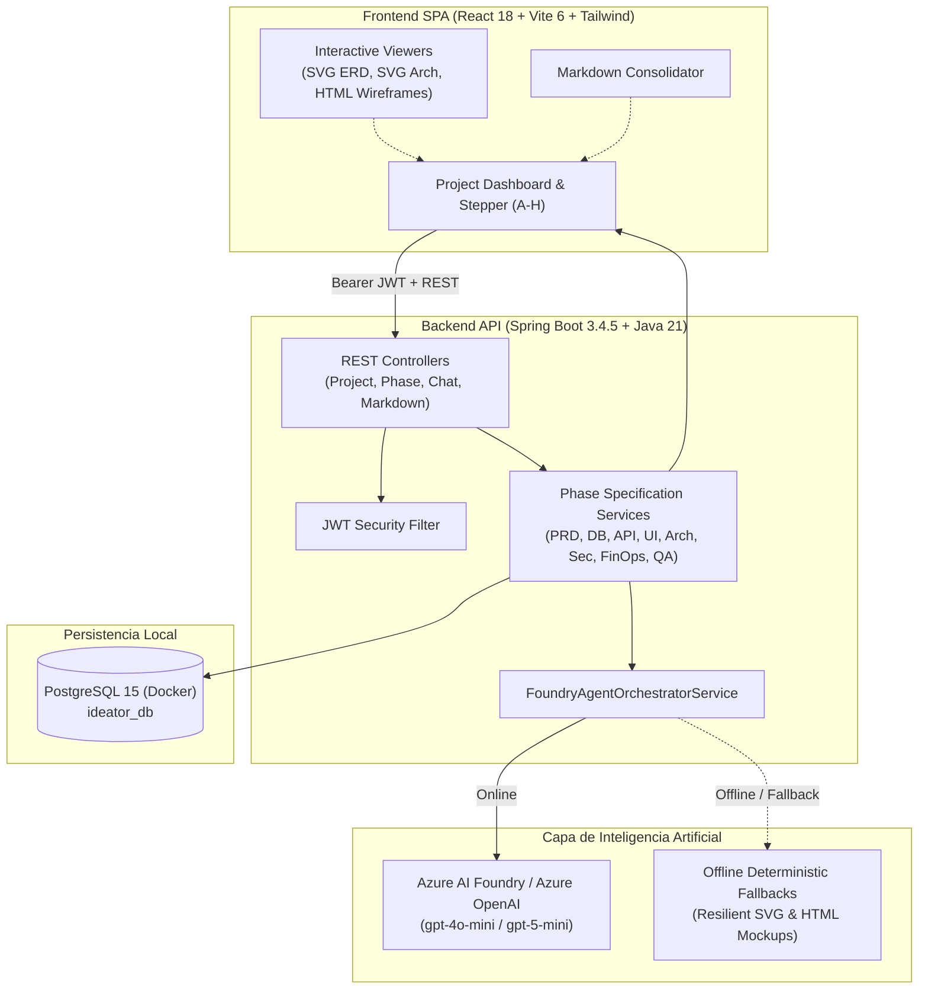

# Ideator - Plataforma de Arquitectura de Software Asistida por IA

Plataforma empresarial asistida por Inteligencia Artificial diseñada para transformar ideas de producto en especificaciones técnicas de ingeniería de software completas, rigurosas y ejecutables. 

Integra un **Pipeline Multi-Agente de 8 Fases (A a la H)**, generación de diagramas interactivos en SVG, maquetación visual interactiva en HTML, estimación de costos cloud y una suite de pruebas automatizadas en backend y frontend.

> **Estado del Proyecto:** Pipeline Multi-Agente (Fases A → H), Visores Interactivos y Suite de Pruebas Automatizadas completados y verificados.

---

## Contenido

- [Descripción](#descripción)
- [Pipeline de Fases Técnicas (A - H)](#pipeline-de-fases-técnicas-a---h)
- [Arquitectura del Sistema](#arquitectura-del-sistema)
- [Stack Tecnológico](#stack-tecnológico)
- [Estructura del Repositorio](#estructura-del-repositorio)
- [Requisitos Previos](#requisitos-previos)
- [Inicio Rápido](#inicio-rápido)
- [Variables de Entorno](#variables-de-entorno)
- [API REST](#api-rest)
- [Pruebas Automatizadas y Calidad](#pruebas-automatizadas-y-calidad)
- [Solución de Problemas](#solución-de-problemas)
- [Seguridad](#seguridad)

---

## Descripción

**Ideator** permite a arquitectos, product managers y desarrolladores evolucionar conceptos de software hacia documentación técnica de nivel industrial. Mediante la orquestación de agentes especializados (impulsados por **Azure AI Foundry / Azure OpenAI** con modelos de razonamiento y generación como `gpt-4o-mini` y `gpt-5-mini`), el sistema genera especificaciones conectadas y coherentes.

### Capacidades Principales:
- **Orquestación Multi-Agente:** Cada fase técnica es atendida por un agente especializado con prompts de dominio y validación estructural.
- **Modo Resiliente / Offline:** Todos los servicios disponen de generadores determinísticos de respaldo (*fallbacks*) en caso de falta de conexión o cuota de API.
- **Generación Secuencial con 1-Click:** Capacidad de ejecutar el pipeline completo de la Fase A a la H con feedback visual animado en tiempo real.
- **Artefactos Visuales Interactivos:** 
  - **Fase D (UI/UX):** Mockup interactivo HTML/CSS en sandbox seguro (`<iframe>`) con selector entre vista previa funcional y código fuente.
  - **Fase B (Base de Datos):** Diagrama Entidad-Relación (ERD) interactivo en formato SVG descargable.
  - **Fase G / E (Arquitectura Cloud & DevOps):** Diagrama de topología y microservicios en formato SVG responsivo y descargable.
- **Exportación Técnica Consolidada:** Generación de un reporte técnico integral en Markdown para el cliente o equipo de desarrollo.

---

## Pipeline de Fases Técnicas (A - H)

| Fase | Nombre | Agente Asignado | Entregable Principal |
| :---: | :--- | :--- | :--- |
| **A** | **PRD & Historias de Usuario** | `ideator-prd-agent` | Requerimientos funcionales/no funcionales y criterios Gherkin (`Given-When-Then`). |
| **B** | **Base de Datos & DDL** | `ideator-db-agent` | Script DDL PostgreSQL (tablas, PK/FK, índices) y **Diagrama ERD en SVG**. |
| **C** | **Contratos de API REST** | `ideator-api-agent` | Especificación OpenAPI 3.0 / Swagger, schemas JSON y códigos de respuesta. |
| **D** | **UI/UX & Wireframes** | `ideator-ui-agent` | Mapa de navegación, inventario de pantallas y **Mockup Visual Interactivo en HTML**. |
| **E** | **Arquitectura & DevOps** | `ideator-arch-agent` | Topología de microservicios, `docker-compose.yml` y **Diagrama de Arquitectura en SVG**. |
| **F** | **Seguridad & Amenazas** | `ideator-security-agent` | Modelado de amenazas STRIDE, matriz de mitigación y checklist OWASP Top 10. |
| **G** | **FinOps & Costos Cloud** | `ideator-finops-agent` | Estimación mensual en Azure/AWS, dimensionamiento de instancias y estrategias de ahorro. |
| **H** | **QA & Plan de Pruebas** | `ideator-qa-agent` | Casos de prueba, matriz de cobertura, tests de regresión y pirámide de pruebas. |

---

## Arquitectura del Sistema



---

## Stack Tecnológico

| Capa | Tecnologías Clave | Versión / Detalle |
| :--- | :--- | :--- |
| **Backend** | Java, Spring Boot | **Java 21**, **Spring Boot 3.4.5** |
| **Seguridad** | Spring Security, JJWT | Autenticación Stateless JWT (HS256), BCrypt Password Hashing |
| **Persistencia** | Spring Data JPA, Hibernate, PostgreSQL | PostgreSQL 15 en contenedor Docker |
| **Frontend** | React, TypeScript, Vite | **React 18**, **TypeScript 5**, **Vite 6**, Tailwind CSS 3 |
| **Visualización** | Lucide React, Mermaid, SVG Nativo, HTML5 Sandbox | Renderizado seguro de diagramas y wireframes interactivos |
| **Inteligencia Artificial** | Azure OpenAI SDK, Azure AI Foundry | Soporte para `gpt-4o-mini` y orquestación multi-agente |
| **Testing Backend** | JUnit 5, Mockito, AssertJ, Spring Test | 23 pruebas automatizadas (unitarias y de integración) |

---

## Estructura del Repositorio

```text
.
├── backend/
│   ├── src/main/java/com/ideator/backend/
│   │   ├── config/            # Configuración de Seguridad, Azure AI y CORS
│   │   ├── domain/            # Entidades JPA (User, Project, ProjectMember)
│   │   ├── dto/               # DTOs tipados por fase (DbSpec, UiMap, ArchSpec, etc.)
│   │   ├── model/             # PhaseSpecification y entidades de soporte
│   │   ├── repository/        # Repositorios Spring Data JPA
│   │   ├── security/          # Filtros JWT y UserDetailsService
│   │   ├── service/           # Lógica de orquestación y servicios por fase (A-H)
│   │   └── web/               # Controladores REST (Auth, Project, Phase, Chat, Export)
│   ├── src/test/java/         # 23 pruebas automatizadas (Servicios, Mocks, Controladores)
│   ├── mvnw.cmd / mvnw        # Maven Wrapper
│   └── pom.xml
├── frontend/
│   ├── src/
│   │   ├── components/        # Visores por fase (DatabaseSpecEditor, UiMapViewer, etc.)
│   │   ├── context/           # AuthContext, ThemeContext
│   │   ├── lib/               # Configuración de Axios con interceptor Bearer
│   │   ├── pages/             # Login, Dashboard, ProjectView (Stepper A-H en vivo)
│   │   ├── services/          # Clientes HTTP (auth, project, phaseService, markdown)
│   │   └── types/             # Tipado TypeScript unificado (Phase, UiMap, DbSpec, etc.)
│   ├── package.json
│   └── vite.config.ts
├── docker-compose.yml         # Contenedor PostgreSQL 15 con volumen persistente
├── .gitignore
└── README.md
```

---

## Requisitos Previos

- **Java Development Kit (JDK) 21** configurado en `JAVA_HOME`.
- **Node.js 20+** y `npm`.
- **Docker Desktop** con soporte para Docker Compose.
- Git.

---

## Inicio Rápido

### 1. Iniciar la Base de Datos

En la raíz del proyecto:

```powershell
docker compose up -d
```

Verifica que el contenedor `ideator-postgres` esté saludable en el puerto `5432`:

```powershell
docker compose ps
```

### 2. Iniciar el Backend

```powershell
cd backend
.\mvnw.cmd spring-boot:run
```

*La API estará disponible en `http://localhost:8080`.*

### 3. Iniciar el Frontend

En una terminal independiente:

```powershell
cd frontend
npm install
npm run dev
```

*La aplicación web estará disponible en `http://localhost:3000`.*

### 4. Credenciales de Demostración

El sistema incluye un seeder automático de desarrollo:
- **Correo:** `demo@ideator.com`
- **Contraseña:** `Demo1234!`

---

## Variables de Entorno

### Backend (`application.yml` o Variables del Sistema)

| Variable | Valor por Defecto | Descripción |
| :--- | :--- | :--- |
| `SERVER_PORT` | `8080` | Puerto del servidor backend |
| `SPRING_DATASOURCE_URL` | `jdbc:postgresql://localhost:5432/ideator_db` | Cadena de conexión JDBC |
| `SPRING_DATASOURCE_USERNAME` | `ideator_user` | Usuario de PostgreSQL |
| `SPRING_DATASOURCE_PASSWORD` | `ideator_pass` | Contraseña de PostgreSQL |
| `JWT_SECRET` | *Clave de desarrollo* | Clave criptográfica para firma de JWT (HS256) |
| `AZURE_OPENAI_ENDPOINT` | *(Opcional)* | URL del recurso de Azure AI Foundry |
| `AZURE_OPENAI_KEY` | *(Opcional)* | API Key del recurso Azure OpenAI |
| `AZURE_OPENAI_DEPLOYMENT` | `gpt-4o-mini` | Nombre del modelo o despliegue configurado |

> **Nota de Resiliencia:** Si las credenciales de Azure OpenAI no están presentes o se encuentran sin cuota, el backend conmuta de forma automática y transparente al motor de **fallbacks determinísticos**, garantizando la operatividad total del sistema y la generación de especificaciones, diagramas y mockups.

---

## API REST

### Autenticación & Usuarios
- `POST /api/v1/auth/register` — Registro de nuevo usuario.
- `POST /api/v1/auth/login` — Autenticación y emisión de token JWT.
- `GET /api/v1/auth/me` — Perfil del usuario autenticado.

### Proyectos
- `GET /api/v1/projects` — Listar proyectos del usuario.
- `POST /api/v1/projects` — Crear nuevo proyecto.
- `GET /api/v1/projects/{id}` — Detalle de proyecto.
- `PUT /api/v1/projects/{id}` — Actualizar información de proyecto.
- `DELETE /api/v1/projects/{id}` — Eliminar proyecto.

### Pipeline de Especificaciones Técnicas (Fases A a H)
- `GET /api/v1/projects/{projectId}/phases/{phase}` — Obtener el contenido estructurado de la fase indicada (`PHASE_A` a `PHASE_H`).
- `POST /api/v1/projects/{projectId}/phases/{phase}/generate` — Disparar la generación asistida por IA para la fase.
- `PUT /api/v1/projects/{projectId}/phases/{phase}` — Guardar manualmente ediciones técnicas sobre la fase.

### Exportación Técnica
- `GET /api/v1/projects/{projectId}/export/markdown` — Genera y descarga el documento técnico consolidado en Markdown que engloba todas las fases del proyecto.

### Asistente & Chat
- `POST /api/v1/chat` — Interacción contextual por chat con la IA respecto al proyecto y su arquitectura.

---

## Pruebas Automatizadas y Calidad

El proyecto cuenta con una cobertura integral de pruebas automatizadas en backend y frontend para asegurar la no-regresión.

### Ejecutar Pruebas del Backend (JUnit 5 & Mockito)

```powershell
cd backend
.\mvnw.cmd test
```

**Resultado:** **23 / 23 Tests Pasando (0 errores, 0 fallos)**
- `ArchitectureSpecServiceTest`: Validación de generación y fallbacks de arquitectura y SVG.
- `DatabaseSpecServiceTest`: Validación de generación de scripts DDL y ERD SVG.
- `UiMapServiceTest`: Validación de serialización de mapa de navegación y wireframe HTML.
- `FoundryAgentOrchestratorServiceTest`: Verificación de resiliencia ante ausencias de API key.
- `MarkdownGeneratorServiceTest`: Integridad de exportación consolidada a Markdown.
- `AzureAiChatServiceTest`: Verificación del flujo de mensajería contextual.

### Ejecutar Verificación y Build del Frontend

```powershell
cd frontend
npm run build
```

**Resultado:** Compilación TypeScript (`tsc`) sin errores de tipos y empaquetado Vite (`vite build`) exitoso.

---

## Solución de Problemas

1. **Conflicto de puerto PostgreSQL (5432):**
   Si tienes otra instancia local de PostgreSQL activa, puedes mapear otro puerto en `docker-compose.yml` (ej. `5434:5432`) y definir:
   ```powershell
   $env:SPRING_DATASOURCE_URL="jdbc:postgresql://localhost:5434/ideator_db"
   ```

2. **Error de variables de entorno no cargadas:**
   Asegúrate de copiar `.env.example` a `.env` en `frontend/` si requieres cambiar la URL de la API:
   ```powershell
   VITE_API_URL=http://localhost:8080/api
   ```

---

## Seguridad

- **Tokens JWT Stateless:** Caducidad configurada y validación criptográfica en cada petición protegida.
- **Protección de Datos Sensibles:** Archivos de configuración `.env` y credenciales privadas ignorados en `.gitignore`.
- **Renderizado Seguro de UI:** Los wireframes generados en HTML son aislados mediante sandboxing estricto (`sandbox="allow-same-origin"`) en el frontend para prevenir ejecución de scripts no autorizados.
