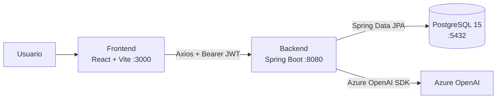

# Ideator

Plataforma asistida por IA para convertir ideas de software en especificaciones técnicas rigurosas. Este repositorio es la raíz del monorepo e integra el backend, el frontend y la base de datos del proyecto.

> **Estado:** Sprint 1 completado. Autenticación, gestión de proyectos y base de integración con Azure OpenAI implementadas y verificadas.

## Contenido

- [Descripción](#descripción)
- [Alcance del Sprint 1](#alcance-del-sprint-1)
- [Arquitectura](#arquitectura)
- [Stack tecnológico](#stack-tecnológico)
- [Estructura del repositorio](#estructura-del-repositorio)
- [Requisitos previos](#requisitos-previos)
- [Inicio rápido](#inicio-rápido)
- [Variables de entorno](#variables-de-entorno)
- [API REST](#api-rest)
- [Autenticación JWT](#autenticación-jwt)
- [Azure OpenAI](#azure-openai)
- [Pruebas y verificación](#pruebas-y-verificación)
- [Solución de problemas](#solución-de-problemas)
- [Roadmap](#roadmap)
- [Flujo de trabajo](#flujo-de-trabajo)
- [Seguridad](#seguridad)

## Descripción

Ideator permite registrar ideas de producto y evolucionarlas hacia documentos de especificación. El Sprint 1 establece la base técnica: autenticación de usuarios, proyectos multiusuario, persistencia en PostgreSQL y un endpoint de salud que comprueba la conexión con Azure OpenAI.

El repositorio es un monorepo:

- `backend/`: API REST con Spring Boot.
- `frontend/`: aplicación SPA con React y Vite.
- `docker-compose.yml`: PostgreSQL 15 para desarrollo local.

## Alcance del Sprint 1

- [x] Registro e inicio de sesión con contraseñas BCrypt.
- [x] Emisión y validación de JWT stateless.
- [x] Protección de rutas privadas en el frontend.
- [x] CRUD de proyectos con propietario y miembros.
- [x] Control de acceso por rol de proyecto (`OWNER`, `EDITOR`, `VIEWER`).
- [x] Seed de usuario y proyecto de demostración.
- [x] Endpoints de salud para base de datos y Azure OpenAI.
- [x] PostgreSQL 15 con Docker Compose y volumen persistente.
- [x] CORS configurable y respuestas JSON uniformes para errores.
- [ ] Generación de especificaciones con IA (Sprint 2).
- [ ] Tests automatizados de integración (pendiente).

## Arquitectura



Flujo principal:

1. El usuario inicia sesión desde el frontend.
2. El backend valida las credenciales y devuelve un JWT.
3. Axios adjunta el token en cada petición protegida.
4. El filtro JWT valida el token y carga el usuario en el contexto de seguridad.
5. Los servicios aplican las reglas de acceso sobre los proyectos.

## Stack tecnológico

| Capa | Tecnologías |
| --- | --- |
| Backend | Java 21, Spring Boot 3.4.5, Spring Web, Spring Data JPA, Spring Security, JJWT 0.12.6, Lombok |
| Base de datos | PostgreSQL 15, Hibernate |
| Frontend | React 18, TypeScript 5, Vite 6, Tailwind CSS 3, React Router 7, Axios |
| IA | Azure OpenAI SDK `1.0.0-beta.16` |
| Infraestructura local | Docker Compose, PostgreSQL 15 Alpine |

## Estructura del repositorio

```text
.
├── backend/
│   ├── src/main/java/com/ideator/backend/
│   │   ├── config/        # Seguridad, propiedades JWT/Azure y seed
│   │   ├── domain/        # Entidades JPA y enums
│   │   ├── dto/           # Requests y responses
│   │   ├── exception/     # Manejo global de errores
│   │   ├── repository/    # Repositorios Spring Data
│   │   ├── security/      # JWT, filtro y UserDetails
│   │   ├── service/       # Reglas de negocio
│   │   └── web/           # Controladores REST
│   ├── src/main/resources/application.yml
│   ├── mvnw
│   ├── mvnw.cmd
│   └── pom.xml
├── frontend/
│   ├── src/
│   │   ├── components/    # Navbar y rutas protegidas
│   │   ├── context/       # AuthContext
│   │   ├── lib/           # Cliente Axios y almacenamiento del token
│   │   ├── pages/         # Login, Dashboard y ProjectView
│   │   ├── services/      # Llamadas a la API
│   │   └── types/         # Tipos compartidos
│   ├── .env.example
│   └── package.json
├── docker-compose.yml
├── .gitignore
└── README.md
```

## Requisitos previos

- **Java 21** (`JAVA_HOME` apuntando al JDK 21).
- **Docker Desktop** con Docker Compose v2.
- **Node.js 20+** y npm.
- No es necesario instalar Maven: el backend incluye Maven Wrapper.

Verificar el entorno:

```powershell
java -version
docker --version
docker compose version
node --version
npm --version
```

## Inicio rápido

### 1. Levantar PostgreSQL

Desde la raíz del repositorio:

```powershell
docker compose up -d
docker compose ps
```

El contenedor se llama `ideator-postgres` y expone el puerto `5432` por defecto. Los datos se conservan en el volumen `ideator_pgdata`.

### 2. Ejecutar el backend

```powershell
cd backend
.\mvnw.cmd spring-boot:run
```

En Linux o macOS:

```bash
cd backend
./mvnw spring-boot:run
```

La API queda disponible en `http://localhost:8080`. Para comprobar el estado:

```powershell
Invoke-RestMethod http://localhost:8080/api/health
```

### 3. Ejecutar el frontend

En otra terminal:

```powershell
cd frontend
npm install
npm run dev
```

La aplicación se abre en `http://localhost:3000`.

### 4. Iniciar sesión con el usuario demo

| Campo | Valor |
| --- | --- |
| Correo | `demo@ideator.com` |
| Contraseña | `Demo1234!` |

El seed crea además un proyecto de ejemplo. Se puede desactivar con `APP_SEED_ENABLED=false`.

## Variables de entorno

### Backend

Spring Boot lee variables de entorno del sistema. Los valores indicados son los predeterminados en `backend/src/main/resources/application.yml`.

| Variable | Predeterminado | Descripción |
| --- | --- | --- |
| `SERVER_PORT` | `8080` | Puerto HTTP de la API. |
| `SPRING_DATASOURCE_URL` | `jdbc:postgresql://localhost:5432/ideator_db` | URL JDBC de PostgreSQL. |
| `SPRING_DATASOURCE_USERNAME` | `ideator_user` | Usuario de la base de datos. |
| `SPRING_DATASOURCE_PASSWORD` | `ideator_pass` | Contraseña de la base de datos. |
| `JPA_DDL_AUTO` | `update` | Estrategia de Hibernate. Usar `validate` en producción. |
| `JPA_SHOW_SQL` | `false` | Muestra el SQL generado. |
| `CORS_ALLOWED_ORIGINS` | `http://localhost:3000` | Orígenes permitidos, separados por coma. |
| `APP_SEED_ENABLED` | `true` | Crea el usuario y proyecto demo. |
| `JWT_SECRET` | secreto de desarrollo | Clave de firma HS256. **Cambiar en producción.** |
| `JWT_EXPIRATION_MS` | `86400000` | Vigencia del token (24 horas). |
| `AZURE_OPENAI_ENDPOINT` | vacío | Endpoint del recurso Azure OpenAI. |
| `AZURE_OPENAI_KEY` | vacío | API key de Azure OpenAI. |
| `AZURE_OPENAI_DEPLOYMENT` | `gpt-4o-mini` | Nombre del deployment. |

Ejemplo en PowerShell:

```powershell
$env:JWT_SECRET='una-clave-segura-de-al-menos-32-caracteres'
$env:SPRING_DATASOURCE_URL='jdbc:postgresql://localhost:5432/ideator_db'
cd backend
.\mvnw.cmd spring-boot:run
```

### Frontend

| Variable | Predeterminado | Descripción |
| --- | --- | --- |
| `VITE_API_URL` | `http://localhost:8080/api` | URL base de la API. |

Crear `frontend/.env.local` a partir de `frontend/.env.example` si se usa otro puerto o servidor.

## API REST

URL base: `http://localhost:8080`.

### Autenticación

| Método | Endpoint | Acceso | Descripción |
| --- | --- | --- | --- |
| `POST` | `/api/v1/auth/register` | Público | Registra un usuario y devuelve un JWT. |
| `POST` | `/api/v1/auth/login` | Público | Inicia sesión y devuelve un JWT. |
| `GET` | `/api/v1/auth/me` | Autenticado | Devuelve el usuario actual. |

Ejemplo de login:

```bash
curl -X POST http://localhost:8080/api/v1/auth/login \
  -H "Content-Type: application/json" \
  -d '{"email":"demo@ideator.com","password":"Demo1234!"}'
```

### Proyectos

| Método | Endpoint | Acceso | Descripción |
| --- | --- | --- | --- |
| `GET` | `/api/v1/projects` | Autenticado | Lista los proyectos del usuario. |
| `GET` | `/api/v1/projects/{id}` | Miembro | Obtiene el detalle de un proyecto. |
| `POST` | `/api/v1/projects` | Autenticado | Crea un proyecto; el usuario queda como `OWNER`. |
| `PUT` | `/api/v1/projects/{id}` | `OWNER` o `EDITOR` | Actualiza nombre, descripción o estado. |
| `DELETE` | `/api/v1/projects/{id}` | `OWNER` | Elimina el proyecto. |

Cuerpo para crear o actualizar:

```json
{
  "name": "Mi nuevo proyecto",
  "description": "Descripción breve de la idea",
  "status": "DRAFT"
}
```

Estados disponibles: `DRAFT`, `IN_PROGRESS`, `COMPLETED`, `ARCHIVED`.

### Salud

| Método | Endpoint | Descripción |
| --- | --- | --- |
| `GET` | `/api/health` | Estado de la API, base de datos y Azure. |
| `GET` | `/api/health/azure` | Comprueba la conectividad con Azure OpenAI. |

Ejemplo de respuesta sin Azure configurado:

```json
{
  "status": "UP",
  "database": { "status": "UP" },
  "azure": { "status": "NOT_CONFIGURED", "deployment": "gpt-4o-mini" }
}
```

## Autenticación JWT

1. `POST /api/v1/auth/login` valida las credenciales con BCrypt.
2. El backend firma un token HS256 con `JWT_SECRET` y lo devuelve al cliente.
3. El frontend guarda la sesión y Axios agrega `Authorization: Bearer <token>`.
4. `JwtAuthenticationFilter` valida la firma y la expiración del token.
5. Si el token falta o es inválido, la API responde `401 Unauthorized`.

Las rutas públicas son `/api/health`, `/api/health/**`, `/api/v1/auth/login` y `/api/v1/auth/register`.

## Azure OpenAI

Azure es opcional para el arranque. Si no se configuran credenciales, la aplicación inicia normalmente y `/api/health/azure` responde `NOT_CONFIGURED`.

Configurar en PowerShell:

```powershell
$env:AZURE_OPENAI_ENDPOINT='https://<recurso>.openai.azure.com/'
$env:AZURE_OPENAI_KEY='<clave>'
$env:AZURE_OPENAI_DEPLOYMENT='gpt-4o-mini'
cd backend
.\mvnw.cmd spring-boot:run
```

Con credenciales válidas, `/api/health/azure` devuelve `UP`; con credenciales inválidas o un deployment inexistente devuelve `DOWN`. La clave nunca debe versionarse.

## Pruebas y verificación

### Compilación del backend

```powershell
cd backend
.\mvnw.cmd -DskipTests package
```

### Validación del frontend

```powershell
cd frontend
npm run typecheck
npm run build
```

### Estado verificado

| Verificación | Resultado |
| --- | --- |
| Compilación y empaquetado del backend | Correcto |
| Build de producción del frontend | Correcto |
| PostgreSQL 15 en Docker | Correcto |
| `/api/health` con base de datos | `UP` |
| Login del usuario demo | Correcto |
| Listado, creación, consulta y eliminación de proyectos | Correcto |
| Acceso sin JWT | `401 Unauthorized` |
| Azure sin credenciales | `NOT_CONFIGURED` |
| Llamada real a Azure OpenAI | Pendiente de credenciales |

Sprint 1 no incluye tests automatizados; la verificación anterior se realizó de forma manual contra PostgreSQL real.

## Solución de problemas

**El puerto 5432 está ocupado**

Puede existir otra instancia local de PostgreSQL. Usar otro puerto:

```powershell
$env:POSTGRES_PORT='5434'
docker compose up -d
$env:SPRING_DATASOURCE_URL='jdbc:postgresql://127.0.0.1:5434/ideator_db'
```

En Bash:

```bash
POSTGRES_PORT=5434 docker compose up -d
```

**El backend no conecta con la base de datos**

Comprobar que el contenedor está saludable:

```powershell
docker compose ps
docker compose logs postgres
```

**La API responde 401**

El token expiró o no se envió. Iniciar sesión nuevamente y confirmar el encabezado `Authorization: Bearer <token>`.

**Azure responde `DOWN`**

Revisar `AZURE_OPENAI_ENDPOINT`, `AZURE_OPENAI_KEY` y que el deployment indicado exista en el recurso.

**Error de CORS en el navegador**

Agregar el origen exacto del frontend a `CORS_ALLOWED_ORIGINS`, por ejemplo:

```powershell
$env:CORS_ALLOWED_ORIGINS='http://localhost:3000,http://127.0.0.1:3000'
```

**Maven usa la versión incorrecta de Java**

Definir `JAVA_HOME` antes de ejecutar el wrapper:

```powershell
$env:JAVA_HOME='C:\Program Files\Java\jdk-21'
.\mvnw.cmd -version
```

## Roadmap

- **Sprint 2:** chat guiado por fases (A-E) con Azure OpenAI y streaming.
- Persistencia de conversaciones y documentos generados.
- Gestión de miembros e invitaciones por proyecto.
- Migraciones de base de datos con Flyway.
- Refresh tokens y cierre de sesión del lado del servidor.
- Tests automatizados con Testcontainers.
- Despliegue con perfiles de producción y variables seguras.

## Flujo de trabajo

- Crear ramas desde `develop` con el formato `feature/SCRUM-XX-descripcion`.
- Usar mensajes de commit trazables: `SCRUM-XX: descripción breve`.
- Mantener `main` estable y fusionar mediante Pull Request.
- No versionar `backend/target`, `frontend/node_modules`, `frontend/dist` ni archivos `.env`.
- No incluir claves de Azure, secretos JWT ni contraseñas reales.

Referencia del Sprint 1: `SCRUM-26` (login y protección de rutas privadas).

## Seguridad

La configuración actual está pensada para desarrollo local. Antes de desplegar:

1. Cambiar `JWT_SECRET` por una clave aleatoria de al menos 32 caracteres.
2. Desactivar el seed (`APP_SEED_ENABLED=false`) y eliminar credenciales demo.
3. Usar `JPA_DDL_AUTO=validate` con migraciones controladas.
4. Exigir HTTPS y restringir CORS a los dominios reales.
5. Gestionar `AZURE_OPENAI_KEY` con un almacén de secretos, nunca en el repositorio.
